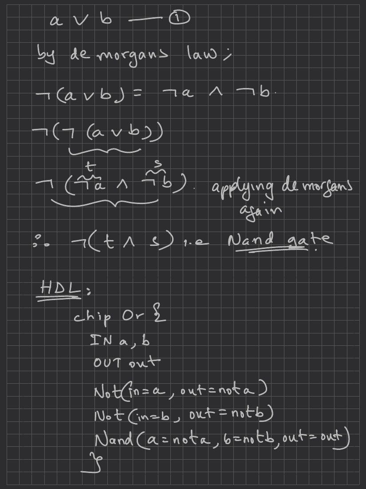
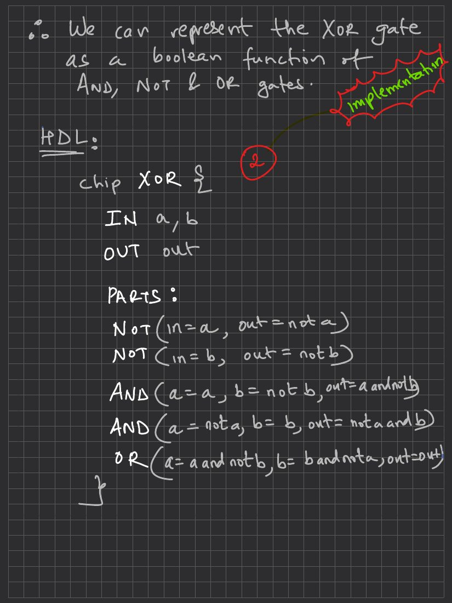

Hey, tomorrow-me. Last night you started **nand2tetris Part 1**, the course where you build a whole computer
from one tiny chip, and you got further than you think. This post is the recap you'll want before you open
Project 1 again: what you read, what you proved on paper, what you built, and where you stopped.

The handwritten pages are yours (15 of them). I've put the useful ones inline so you can check the
original reasoning, not just my summary.

## Where you are

| | Status |
|---|---|
| Course | nand2tetris Part 1 (Nisan & Schocken), suite in `~/nand2tetris` |
| Reading | Unit 1, Boolean logic, up to elementary gates and HDL |
| Notes | *01 - Boolean Logic*, 15 pages |
| Built | `Not`, `And`, `Or`, `Xor`, all four pass their tests |
| Next | `Mux`, `DMux`, then the 16-bit and multi-way chips (11 left in Project 1) |

## 1 · Two values, three operations

Everything starts tiny. A signal has two states. Call them on/off, true/false, yes/no or **1/0**: they're
just the two physical values the system keeps. You're allowed three operations:

| x | y | x ∧ y (And) | x ∨ y (Or) | ¬x (Not) |
|:-:|:-:|:-:|:-:|:-:|
| 0 | 0 | 0 | 0 | 1 |
| 0 | 1 | 0 | 1 | 1 |
| 1 | 0 | 0 | 1 | 0 |
| 1 | 1 | 1 | 1 | 0 |

A **Boolean function** is an expression over some inputs, for example

$$
f(x, y, z) = (x \land y) \lor (\lnot x \land z)
$$

With $N$ inputs there are $2^N$ possible input rows, so you can always write the whole function out as a
finite **truth table**. Keep that in mind: it's what makes everything else in this unit work.


## 2 · The algebra: identities you'll actually use

These are the laws from page 2. Treat them like algebra rules for rewriting expressions:

| Law | And form | Or form |
|---|---|---|
| Commutative | $x \land y = y \land x$ | $x \lor y = y \lor x$ |
| Associative | $x \land (y \land z) = (x \land y) \land z$ | $x \lor (y \lor z) = (x \lor y) \lor z$ |
| Distributive | $x \land (y \lor z) = (x \land y) \lor (x \land z)$ | $x \lor (y \land z) = (x \lor y) \land (x \lor z)$ |
| De Morgan | $\lnot(x \land y) = \lnot x \lor \lnot y$ | $\lnot(x \lor y) = \lnot x \land \lnot y$ |
| Idempotent | $x \land x = x$ | $x \lor x = x$ |

Notice the second distributive law: unlike ordinary arithmetic, **Or distributes over And** too.

You worked one example by hand. Simplify $\lnot(\lnot x \land \lnot(x \lor y))$:

$$
\begin{aligned}
\lnot(x \lor y) &= \lnot x \land \lnot y && \text{De Morgan} \\
\lnot x \land (\lnot x \land \lnot y) &= (\lnot x \land \lnot x) \land \lnot y = \lnot x \land \lnot y && \text{associative, idempotent} \\
\lnot(\lnot x \land \lnot y) &= x \lor y && \text{De Morgan again}
\end{aligned}
$$

A messy expression collapses to $x \lor y$. **Why care:** every operator is a gate on silicon. A shorter
expression is the same chip, only cheaper.


## 3 · Synthesis: from "what it should do" to a formula

You wrote this down as a question, and it's the key idea of the unit:

> Truth table → Boolean expression. Is this the exact operation needed to design a computer?

**Yes.** When you design a component you know what it should *do*. That's the truth table, the **spec**.
Your job is to compose it from primitive gates. The mechanical way is **disjunctive normal form (DNF)**:

1. Go row by row.
2. Pick the rows where $f = 1$.
3. For each one, And all the inputs together, negating the ones that are 0 in that row.
4. Or all those terms together.

Your example has $f = 1$ on rows `000`, `010`, `100`:

$$
f = (\lnot x \land \lnot y \land \lnot z) \lor (\lnot x \land y \land \lnot z) \lor (x \land \lnot y \land \lnot z)
$$

The first two terms differ only in $y$, so they merge:

$$
f = (\lnot x \land \lnot z) \lor (x \land \lnot y \land \lnot z)
$$

You stopped there. One more step: both terms share $\lnot z$, and $\lnot x \lor \lnot y = \lnot(x \land y)$, so

$$
f = \lnot(x \land y) \land \lnot z
$$

Check it against the table: it's 1 only when $z = 0$ and $x, y$ aren't both 1. Those are exactly rows `000`, `010`, `100`. ✓

:::important[Theorem I]
Any Boolean function can be written using only **And, Or and Not**. Proof: the DNF recipe above always works.
:::

:::caution[The catch]
DNF always gives *a* formula, almost never the *shortest* one. Finding the shortest equivalent formula is
computationally hard; the course calls it NP-hard. So there's no general shortcut: real chip design relies
on heuristics and on knowing the patterns.
:::


## 4 · Three gates → two → one: why Nand is enough

This is the part to remember most. It's a chain of three theorems, each one shrinking the toolkit.

**Theorem II: And + Not are enough.** You don't need Or, because De Morgan rewrites it:

$$
\lnot(x \lor y) = \lnot x \land \lnot y \quad\Longrightarrow\quad x \lor y = \lnot(\lnot x \land \lnot y)
$$

:::warning[Fix for page 6]
On page 6 you wrote $\lnot(\lnot(x \land y)) = \lnot(\lnot x \lor \lnot y)$ and then
"$x \land y = \lnot(\lnot x) \land \lnot(\lnot y)$". That step doesn't follow, and the first line expresses
∧ through ∨, which is the wrong direction for this theorem. The line you need is the one above,
$x \lor y = \lnot(\lnot x \land \lnot y)$. Your conclusion was right; only the derivation slipped.
:::

**Meet Nand.** $x \text{ Nand } y = \lnot(x \land y)$. It's 1 everywhere except when both inputs are 1:

| a | b | Nand |
|:-:|:-:|:-:|
| 0 | 0 | 1 |
| 0 | 1 | 1 |
| 1 | 0 | 1 |
| 1 | 1 | 0 |

**Theorem III: Nand alone is enough.** Your proof on page 7 is short and clean. By Theorem II you
only have to build And and Not out of Nand:

$$
\lnot x = x \text{ Nand } x \qquad\qquad x \land y = \lnot(x \text{ Nand } y)
$$

Done. **Every gate of the computer can be built from Nand.** That's the "Nand" in nand2tetris.


## 5 · Gates: interface vs implementation

The book's term for this is *gate logic*: implementing Boolean functions with logic gates. A **logic gate** is a
standalone chip with a well-defined function (its truth table is the spec). There are two kinds:

- **Elementary:** Nand, And, Or, Not…
- **Composite:** Mux, Adder… (built out of elementary ones)

Every gate can be described three equivalent ways: a diagram, a functional description
(`if (a==1 and b==1) then out=0 else out=1` is Nand), and a truth table.

Then comes the idea you'll keep running into, in hardware and in software:

- The **interface** is what the user sees. A 3-input And is three wires in and one wire out.
- The **implementation** is the inside of the black box, e.g. `And(And(a, b), c)`.

A system usually has **a few abstractions and many implementations**. Some are faster, some cheaper,
some more energy-efficient, and the user of the interface never needs to know which one is inside.
In HDL this split is literal: `IN`/`OUT` is the interface, `PARTS:` is the implementation. It's the same deal as an API.

### What the physical layer looks like

You asked yourself "how are these gates realised in hardware?" The simplest answer (page 11) is a battery,
a bulb for `out` and two switches for `a` and `b`:

- Switches in **series** → current flows only if a **and** b are closed → **And**.
- Switches in **parallel** → current flows if a **or** b is closed → **Or**.


You also scribbled "see Claude Shannon!!". Good instinct. His 1937 master's thesis, *A Symbolic Analysis of
Relay and Switching Circuits*, is what showed that Boolean algebra describes switching circuits exactly. Real
chips use transistors as the switches; nand2tetris deliberately stops at the gate and treats the physics
as someone else's layer.

## 6 · What you built (HDL)

All four live in `~/nand2tetris/projects/1/`, and each one's `.out` matches its `.cmp`.

<svg viewBox="0 0 640 230" xmlns="http://www.w3.org/2000/svg" role="img" aria-label="Abstraction ladder: Nand builds Not, And, Or; those build Xor; Mux and friends are next" style="max-width:100%;height:auto;color:currentColor">
  <g fill="none" stroke="currentColor" stroke-width="1.5">
    <rect x="270" y="180" width="100" height="36" rx="6"/>
    <rect x="90" y="100" width="100" height="36" rx="6"/>
    <rect x="270" y="100" width="100" height="36" rx="6"/>
    <rect x="450" y="100" width="100" height="36" rx="6"/>
    <rect x="180" y="20" width="100" height="36" rx="6"/>
    <rect x="340" y="20" width="200" height="36" rx="6" stroke-dasharray="5 4"/>
    <path d="M320 180 L140 136 M320 180 L320 136 M320 180 L500 136"/>
    <path d="M140 100 L230 56 M320 100 L230 56 M500 100 L230 56"/>
    <path d="M320 100 L440 56 M500 100 L440 56 M140 100 L440 56" stroke-dasharray="5 4" opacity="0.5"/>
  </g>
  <g fill="currentColor" font-family="ui-monospace, monospace" font-size="15" text-anchor="middle">
    <text x="320" y="203">Nand</text>
    <text x="140" y="123">Not</text>
    <text x="320" y="123">And</text>
    <text x="500" y="123">Or</text>
    <text x="230" y="43">Xor</text>
    <text x="440" y="43">Mux, DMux… (next)</text>
  </g>
  <g fill="currentColor" font-size="12" opacity="0.7">
    <text x="10" y="203">primitive (given)</text>
    <text x="10" y="123">elementary</text>
    <text x="10" y="43">composite</text>
  </g>
</svg>

```txt title="Not.hdl"
// Not(x) = x Nand x
PARTS:
Nand(a=in, b=in, out=out);
```

```txt title="And.hdl"
// And = Not(Nand)
PARTS:
Nand(a=a, b=b, out=nandAB);
Not(in=nandAB, out=out);
```

```txt title="Or.hdl"
// De Morgan: a ∨ b = ¬(¬a ∧ ¬b) = Nand(¬a, ¬b)
PARTS:
Not(in=a, out=nota);
Not(in=b, out=notb);
Nand(a=nota, b=notb, out=out);
```

You derived `Or` **two ways** on pages 14–15, which is worth remembering:

- **Algebra.** DNF gives $(\lnot a \cdot b) + (a \cdot \lnot b) + (a \cdot b)$. Duplicate $a \cdot b$
  (idempotent), regroup into $b(\lnot a + a) + a(\lnot b + b)$, which is $b + a$.
- **De Morgan.** $a \lor b = \lnot(\lnot a \land \lnot b)$. Name $t = \lnot a$ and $s = \lnot b$ and it reads
  $\lnot(t \land s)$, which **is** a Nand. The HDL above is that line, word for word.



And `Xor`, built straight from the spec with DNF. It's 1 exactly when the inputs differ: rows `01` and `10`, so

$$
\text{Xor}(a, b) = (\lnot a \land b) \lor (a \land \lnot b)
$$

```txt title="Xor.hdl"
CHIP Xor {
    IN a, b;
    OUT out;

    PARTS:
    Not (in=a, out=nota);
    Not (in=b, out=notb);
    And (a=a, b=notb, out=aAndNotb);
    And (a=nota, b=b, out=bAndNota);
    Or  (a=aAndNotb, b=bAndNota, out=out);
}
```



### What each chip costs, counted in Nands

Since everything bottoms out in Nand, count what you built:

| Chip | Your build | Nand gates |
|---|---|:-:|
| Not | Nand | 1 |
| And | Nand + Not | 2 |
| Or | 2 × Not + Nand | 3 |
| Xor | 2 × Not + 2 × And + Or | 2 + 4 + 3 = **9** |

:::tip[A challenge for later]
Your Xor is correct and readable. But Xor can be built from **4** Nands. Try to find it once Project 1 is done.
That's the "many implementations behind one interface" idea in practice: same truth table, less than half the gates.
:::

## 7 · Questions you left yourself

- [x] *How do we build Boolean functions with specific behaviours?* → Synthesis (DNF), section 3.
- [ ] *How are 0 and 1 physically implemented in chips?* Switch circuits are the toy answer;
  transistors (CMOS) are the real one. Look up how a CMOS Nand is two transistors in series plus two in parallel.
- [ ] Read Shannon's 1937 thesis.

## 8 · Next session

Open `~/nand2tetris/projects/1/` and do **Mux** then **DMux**. Use the same recipe: write the truth table
(Mux has three inputs, `a`, `b`, `sel`, so 8 rows), take the DNF, simplify, write the HDL. Then the 16-bit
versions are the same chip repeated across a bus.

<details>
<summary>Hint for Mux (open only if stuck)</summary>

Mux outputs `a` when `sel = 0` and `b` when `sel = 1`. After simplifying, the DNF has just two terms:
one that lets `a` through when `sel` is 0, one that lets `b` through when `sel` is 1.

</details>

## Cheat sheet

- Spec = truth table. Implementation = gates. HDL: `IN`/`OUT` is the interface, `PARTS` the implementation.
- DNF: one And-term per 1-row, Or them together. It always works but is rarely the shortest.
- De Morgan: $\lnot(x \land y) = \lnot x \lor \lnot y$ and $\lnot(x \lor y) = \lnot x \land \lnot y$.
- $\lnot x = x \text{ Nand } x$, $x \land y = \lnot(x \text{ Nand } y)$, $x \lor y = (\lnot x) \text{ Nand } (\lnot y)$.
- And, Or, Not → And, Not → Nand. One gate builds the computer.

See you at the Mux, me.
