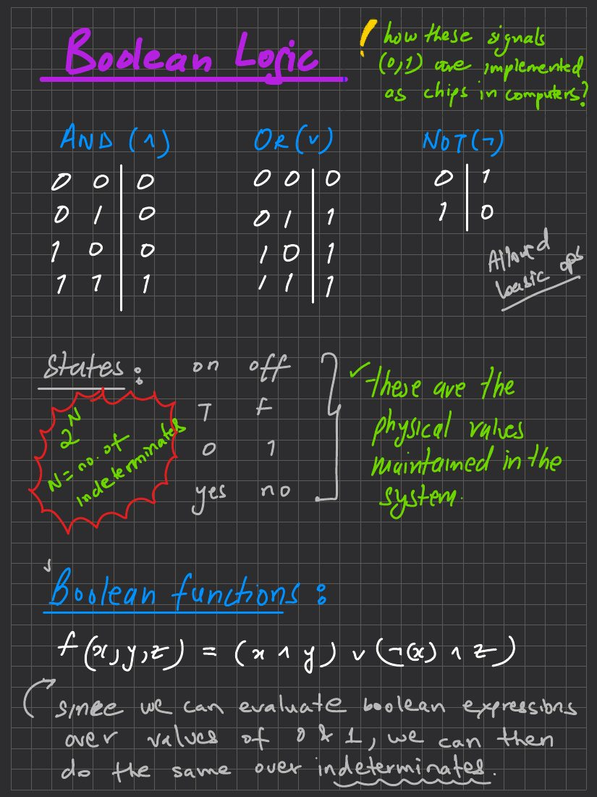
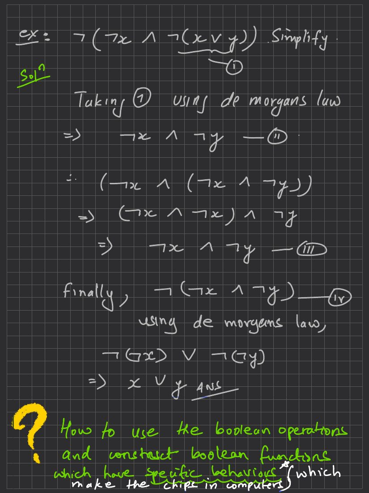
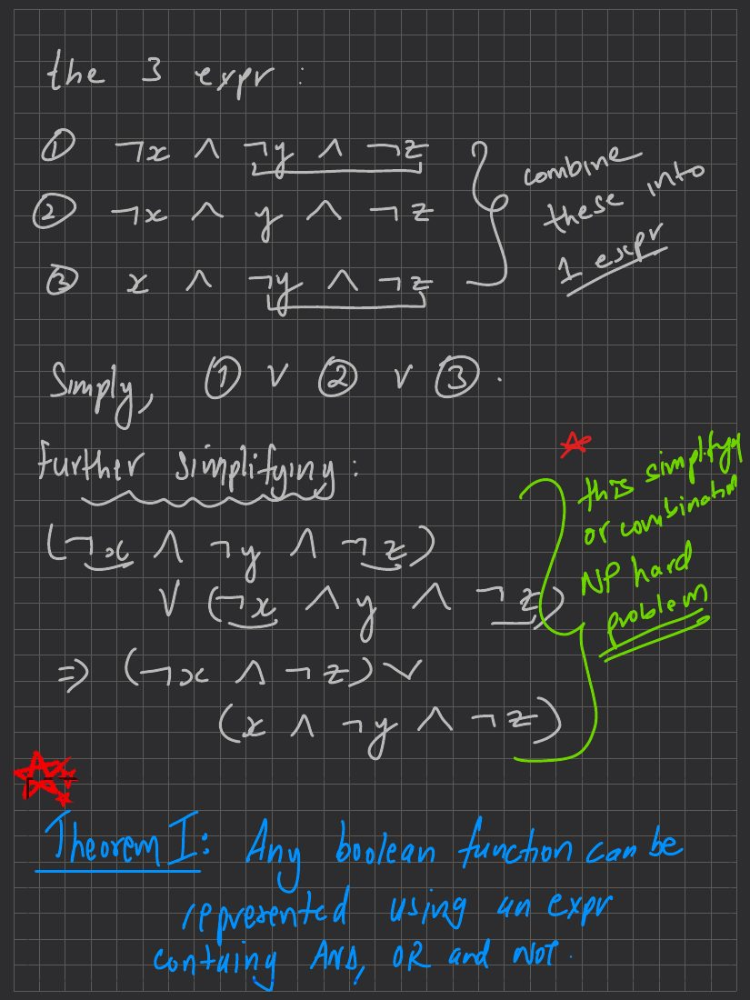
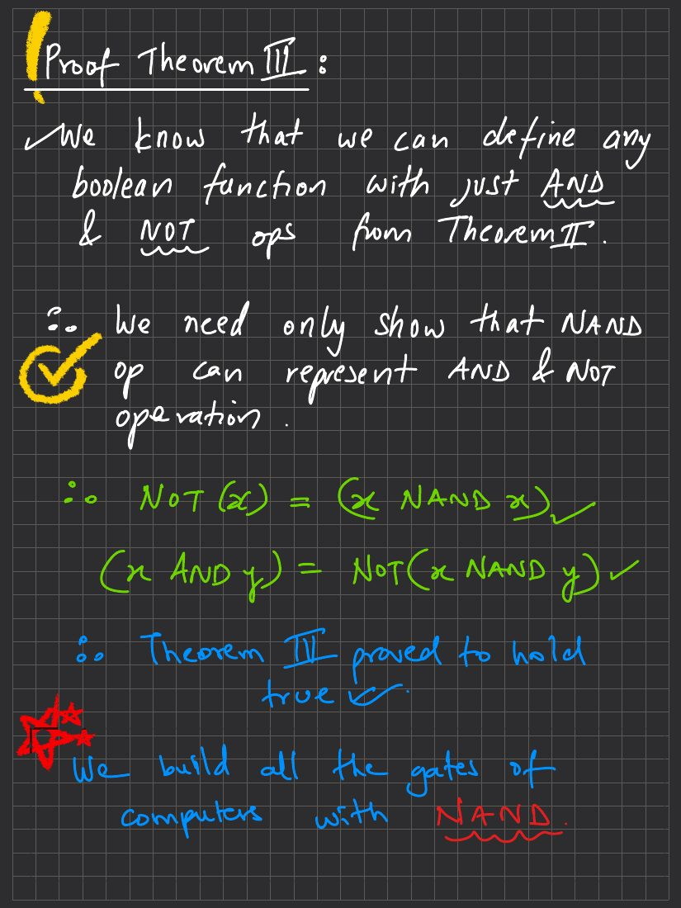
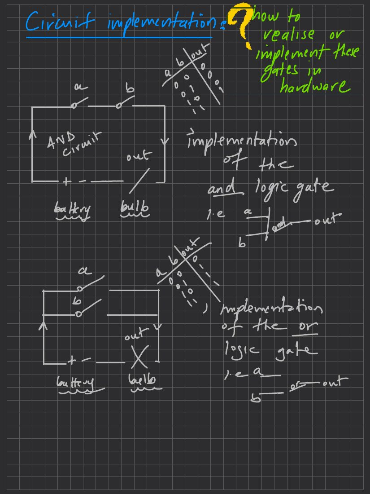

I've started **nand2tetris Part 1**, Noam Nisan and Shimon Schocken's course where you build a working computer
starting from a single logic gate. Unit 1 is Boolean logic. I worked through the lectures with a pen, filled 15 pages of
notes, and built my first four chips in their hardware description language (HDL).

This post covers what I learned, what I built, and the questions I'm taking into the next unit. I've
included some of the handwritten pages where they show the reasoning better than a summary would.

## Where things stand

| | |
|---|---|
| Course | nand2tetris Part 1 ([nand2tetris.org](https://www.nand2tetris.org/)) |
| Covered | Unit 1: Boolean logic, gate logic, HDL |
| Built | `Not`, `And`, `Or`, `Xor`, all passing the course's test scripts |
| Next | `Mux`, `DMux`, then the 16-bit and multi-way chips (11 left in Project 1) |

## Two values, three operations

The starting point is tiny. A signal has two states. You can call them on/off, true/false or yes/no; the
course writes **1/0**. Whatever the name, they're the two physical values the hardware holds. There are three
basic operations:

| x | y | x ∧ y (And) | x ∨ y (Or) | ¬x (Not) |
|:-:|:-:|:-:|:-:|:-:|
| 0 | 0 | 0 | 0 | 1 |
| 0 | 1 | 0 | 1 | 1 |
| 1 | 0 | 0 | 1 | 0 |
| 1 | 1 | 1 | 1 | 0 |

A **Boolean function** is an expression built from them, for example

$$
f(x, y, z) = (x \land y) \lor (\lnot x \land z)
$$

With $N$ inputs there are only $2^N$ input combinations, so any Boolean function can be written out completely
as a finite **truth table**. The rest of the unit depends on this fact.



## The algebra

Boolean expressions follow algebraic laws, and these are the ones I ended up using:

| Law | And form | Or form |
|---|---|---|
| Commutative | $x \land y = y \land x$ | $x \lor y = y \lor x$ |
| Associative | $x \land (y \land z) = (x \land y) \land z$ | $x \lor (y \lor z) = (x \lor y) \lor z$ |
| Distributive | $x \land (y \lor z) = (x \land y) \lor (x \land z)$ | $x \lor (y \land z) = (x \lor y) \land (x \lor z)$ |
| De Morgan | $\lnot(x \land y) = \lnot x \lor \lnot y$ | $\lnot(x \lor y) = \lnot x \land \lnot y$ |
| Idempotent | $x \land x = x$ | $x \lor x = x$ |

One surprise: unlike ordinary arithmetic, **Or distributes over And** as well as the other way round.

The exercise that made this click for me was simplifying $\lnot(\lnot x \land \lnot(x \lor y))$:

$$
\begin{aligned}
\lnot(x \lor y) &= \lnot x \land \lnot y && \text{De Morgan} \\
\lnot x \land (\lnot x \land \lnot y) &= \lnot x \land \lnot y && \text{associative, idempotent} \\
\lnot(\lnot x \land \lnot y) &= x \lor y && \text{De Morgan again}
\end{aligned}
$$

A messy expression collapses to $x \lor y$. This matters for hardware because every operator becomes a physical
gate, so a shorter expression gives the same chip at a lower cost.



## Synthesis: from a spec to a formula

The question I wrote in my margin was: *is going from a truth table to an expression exactly what designing a
computer is?* Mostly, yes. When you design a component you know what it should *do*. That behaviour is the
truth table, and it's the **spec**. The job is to build it out of primitive gates.

The mechanical way to do this is **disjunctive normal form (DNF)**:

1. Go through the truth table row by row.
2. Pick the rows where $f = 1$.
3. For each one, And all the inputs together, negating each input that is 0 in that row.
4. Or the resulting terms together.

Example: a three-input function that is 1 on rows `000`, `010` and `100`:

$$
f = (\lnot x \land \lnot y \land \lnot z) \lor (\lnot x \land y \land \lnot z) \lor (x \land \lnot y \land \lnot z)
$$

The first two terms differ only in $y$, so they merge:

$$
f = (\lnot x \land \lnot z) \lor (x \land \lnot y \land \lnot z)
$$

Both remaining terms share $\lnot z$, and $\lnot x \lor \lnot y = \lnot(x \land y)$, so the whole thing reduces to

$$
f = \lnot(x \land y) \land \lnot z
$$

As a check, this is 1 only when $z = 0$ and $x, y$ are not both 1, which is exactly rows `000`, `010` and `100`.

:::important[Theorem I]
Any Boolean function can be written using only **And, Or and Not**, because the DNF recipe always works.
:::

:::caution[The catch]
DNF always gives *a* formula but rarely the *shortest* one. Finding the minimal equivalent formula is
computationally hard (NP-hard, as the course puts it), so in general there's no efficient shortcut.
:::



## Three operations to two to one: why Nand is enough

This was the highlight of the unit for me: a chain of three theorems, each one shrinking the toolkit.

**Theorem II: And and Not are enough.** Or isn't needed, because De Morgan's law rewrites it:

$$
\lnot(x \lor y) = \lnot x \land \lnot y \quad\Longrightarrow\quad x \lor y = \lnot(\lnot x \land \lnot y)
$$

:::note[An erratum to my own notes]
In my handwritten version (page 6) I went the wrong way round: I wrote And in terms of Or, then took a step
that doesn't follow. The identity Theorem II needs is the one above. Writing this post was how I caught it.
:::

**Nand** is "not and": $x \text{ Nand } y = \lnot(x \land y)$. It outputs 1 everywhere except when both
inputs are 1:

| a | b | Nand |
|:-:|:-:|:-:|
| 0 | 0 | 1 |
| 0 | 1 | 1 |
| 1 | 0 | 1 |
| 1 | 1 | 0 |

**Theorem III: Nand alone is enough.** By Theorem II, it's enough to build And and Not out of Nand:

$$
\lnot x = x \text{ Nand } x \qquad\qquad x \land y = \lnot(x \text{ Nand } y)
$$

So every gate in the computer can be built from Nand, which is where the course gets its name.



## Gates: interface vs implementation

A **logic gate** is a standalone chip with a well-defined function, and its truth table is its spec. There are two kinds:

- **Elementary** gates: Nand, And, Or, Not.
- **Composite** gates such as Mux or an adder, built from elementary ones.

Every gate can be described three equivalent ways: as a diagram, as a functional description
(`if (a==1 and b==1) then out=0 else out=1` is Nand), and as a truth table.

The idea from this section I expect to keep returning to is the split between **interface** and
**implementation**. A 3-input And looks like three wires in and one wire out, and that view is the abstraction. What's
inside, say `And(And(a, b), c)`, is an implementation. A system typically has a few abstractions and many
possible implementations: some faster, some cheaper, some more power-efficient. The user of the interface doesn't
need to know which one is inside. In HDL the split is literal: the `IN`/`OUT` header is the interface and the `PARTS` section
is the implementation. It works the same way as an API in software.

### What the physical layer looks like

How do gates exist physically? The simplest model is a battery, a bulb as the output, and two switches as the
inputs:

- Switches in **series**: current flows only if a **and** b are closed. That's **And**.
- Switches in **parallel**: current flows if a **or** b is closed. That's **Or**.



This is the observation behind Claude Shannon's 1937 master's thesis, *A Symbolic Analysis of Relay and Switching
Circuits*, which showed that Boolean algebra describes switching circuits exactly. Real chips use transistors as the
switches. nand2tetris deliberately stops at the gate and leaves the physics to another layer.

## What I built

Project 1 provides an HDL skeleton, a test script and an expected-output file for each chip. A chip is done when its
output matches the expected output. These four are mine, each built only from chips that already exist below it:

<svg viewBox="0 0 640 230" xmlns="http://www.w3.org/2000/svg" role="img" aria-label="Abstraction ladder: Nand builds Not, And, Or; those build Xor; Mux and friends are next" style="max-width:100%;height:auto;color:currentColor">
  <g fill="none" stroke="currentColor" stroke-width="1.5">
    <rect x="270" y="180" width="100" height="36" rx="6"/>
    <rect x="90" y="100" width="100" height="36" rx="6"/>
    <rect x="270" y="100" width="100" height="36" rx="6"/>
    <rect x="450" y="100" width="100" height="36" rx="6"/>
    <rect x="180" y="20" width="100" height="36" rx="6"/>
    <rect x="340" y="20" width="200" height="36" rx="6" stroke-dasharray="5 4"/>
    <path d="M320 180 L140 136 M320 180 L320 136 M320 180 L500 136"/>
    <path d="M140 100 L230 56 M320 100 L230 56 M500 100 L230 56"/>
    <path d="M320 100 L440 56 M500 100 L440 56 M140 100 L440 56" stroke-dasharray="5 4" opacity="0.5"/>
  </g>
  <g fill="currentColor" font-family="ui-monospace, monospace" font-size="15" text-anchor="middle">
    <text x="320" y="203">Nand</text>
    <text x="140" y="123">Not</text>
    <text x="320" y="123">And</text>
    <text x="500" y="123">Or</text>
    <text x="230" y="43">Xor</text>
    <text x="440" y="43">Mux, DMux… (next)</text>
  </g>
  <g fill="currentColor" font-size="12" opacity="0.7">
    <text x="10" y="203">primitive (given)</text>
    <text x="10" y="123">elementary</text>
    <text x="10" y="43">composite</text>
  </g>
</svg>

```txt title="Not.hdl"
// Not(x) = x Nand x
PARTS:
Nand(a=in, b=in, out=out);
```

```txt title="And.hdl"
// And = Not(Nand)
PARTS:
Nand(a=a, b=b, out=nandAB);
Not(in=nandAB, out=out);
```

```txt title="Or.hdl"
// De Morgan: a ∨ b = ¬(¬a ∧ ¬b) = Nand(¬a, ¬b)
PARTS:
Not(in=a, out=nota);
Not(in=b, out=notb);
Nand(a=nota, b=notb, out=out);
```

I derived `Or` two ways, and both lead to the same three lines:

- **Algebra.** DNF gives $(\lnot a \cdot b) + (a \cdot \lnot b) + (a \cdot b)$. Duplicating $a \cdot b$
  (idempotence) and regrouping gives $b(\lnot a + a) + a(\lnot b + b) = b + a$.
- **De Morgan.** $a \lor b = \lnot(\lnot a \land \lnot b)$. With $t = \lnot a$ and $s = \lnot b$ this is
  $\lnot(t \land s)$, which is a Nand. The HDL above is that sentence written as wiring.


`Xor` came straight from its spec. It's 1 exactly when the inputs differ, which is rows `01` and `10`, so DNF gives

$$
\text{Xor}(a, b) = (\lnot a \land b) \lor (a \land \lnot b)
$$

```txt title="Xor.hdl"
CHIP Xor {
    IN a, b;
    OUT out;

    PARTS:
    Not (in=a, out=nota);
    Not (in=b, out=notb);
    And (a=a, b=notb, out=aAndNotb);
    And (a=nota, b=b, out=bAndNota);
    Or  (a=aAndNotb, b=bAndNota, out=out);
}
```


### What it costs, counted in Nands

Since everything is ultimately made of Nand, the number of Nands is a fair measure of cost:

| Chip | Built from | Nands |
|---|---|:-:|
| Not | Nand | 1 |
| And | Nand + Not | 2 |
| Or | 2 × Not + Nand | 3 |
| Xor | 2 × Not + 2 × And + Or | 2 + 4 + 3 = **9** |

:::tip[An open challenge]
My Xor is correct and readable, but Xor can be built from **4** Nands. Same interface and the same truth table, with
less than half the gates: it's the interface-vs-implementation idea in miniature. I'm saving it for after Project 1.
If you're following along, try it first.
:::

## Open questions

- **How are 0 and 1 physically realised in a chip?** Switch circuits are the toy answer and transistors (CMOS)
  are the real one. A CMOS Nand is two transistors in series and two in parallel, the same pattern as the
  bulb circuits above.
- **Shannon's thesis.** It's on my reading list now.

## Next

`Mux` and `DMux`, using the same method: write the truth table (Mux has three inputs, `a`, `b` and `sel`, so eight rows),
take the DNF, simplify, then write the HDL. After that, the 16-bit chips are the same gate repeated across a bus.

<details>
<summary>Hint for Mux (spoiler)</summary>

Mux outputs `a` when `sel = 0` and `b` when `sel = 1`. After simplifying, the DNF has just two terms: one that
lets `a` through when `sel` is 0, and one that lets `b` through when `sel` is 1.

</details>

## Cheat sheet

- **Spec** = truth table. **Implementation** = gates. In HDL, `IN`/`OUT` is the interface and `PARTS` the implementation.
- **DNF:** one And-term per row where the output is 1, Or them together. It always works and is rarely minimal.
- **De Morgan:** $\lnot(x \land y) = \lnot x \lor \lnot y$ and $\lnot(x \lor y) = \lnot x \land \lnot y$.
- **From Nand:** $\lnot x = x \text{ Nand } x$, $x \land y = \lnot(x \text{ Nand } y)$, $x \lor y = (\lnot x) \text{ Nand } (\lnot y)$.
- And, Or, Not → And, Not → Nand. One gate is enough to build the computer.
