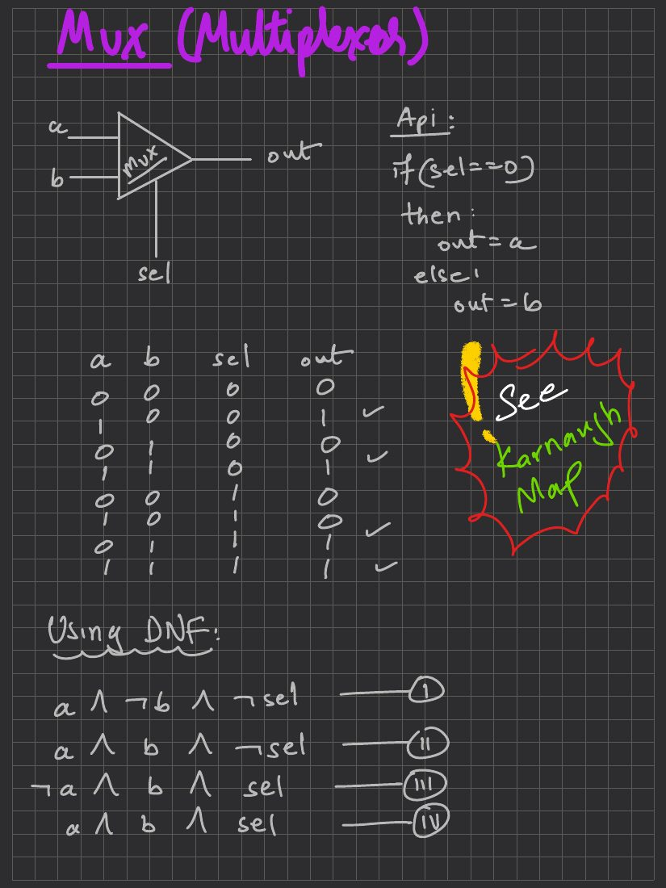
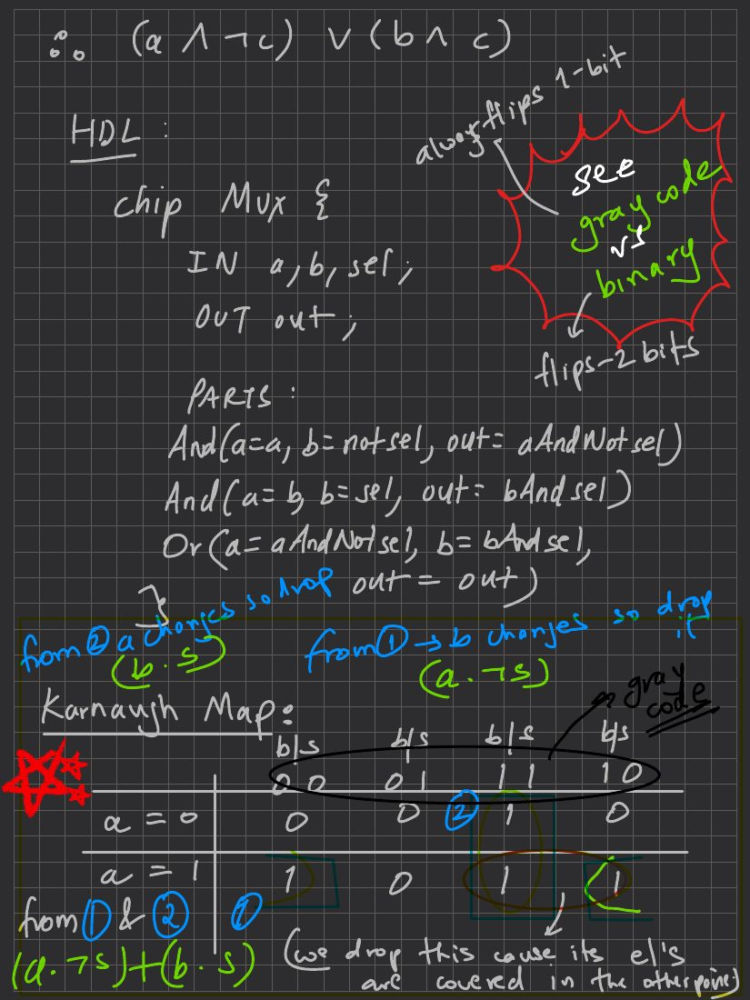
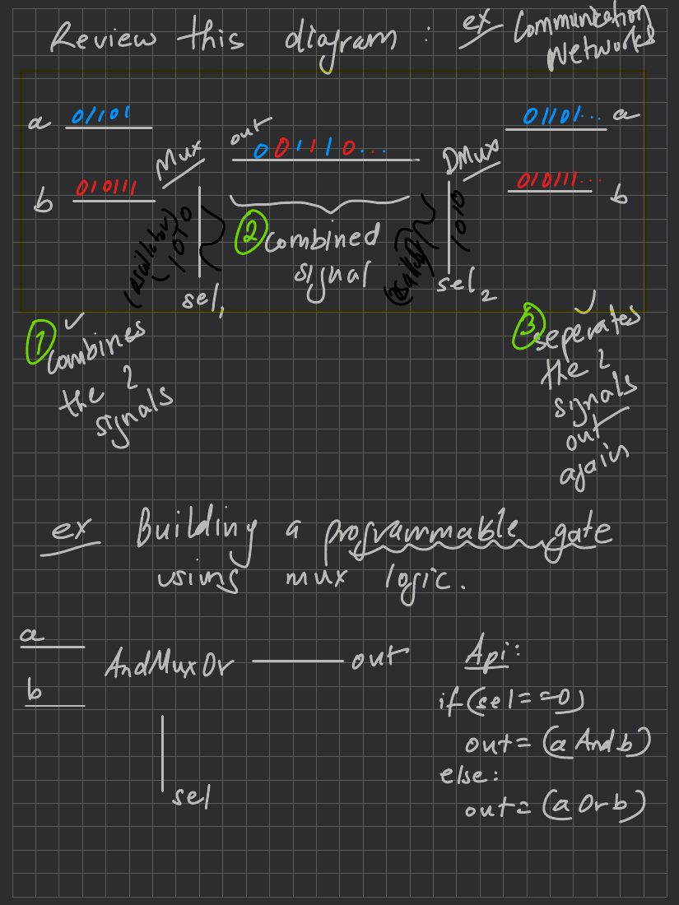
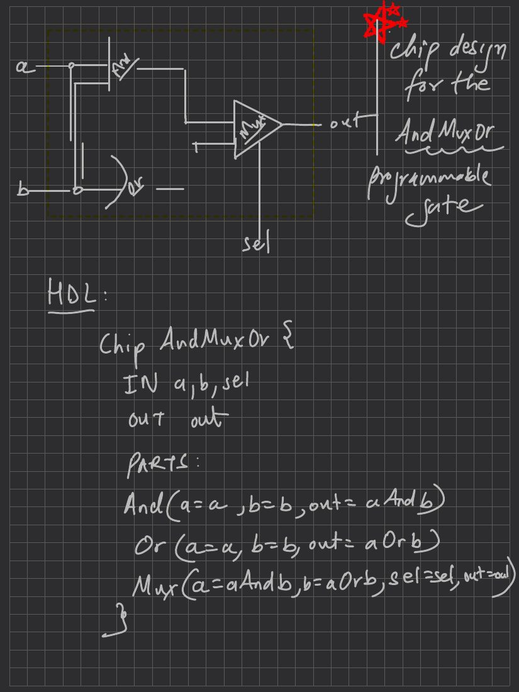
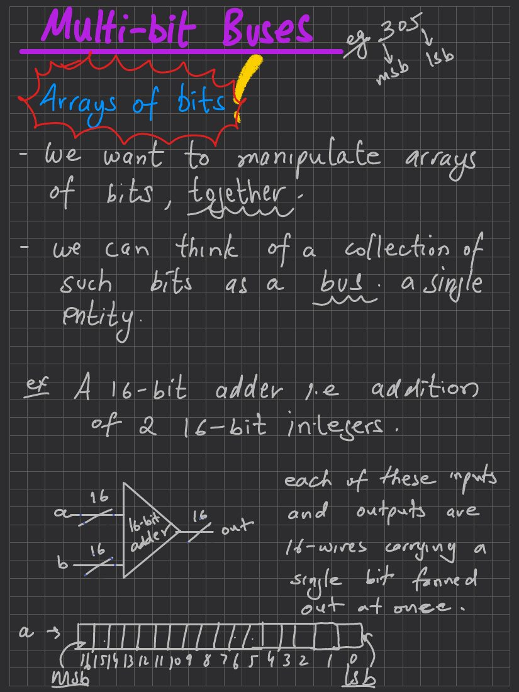
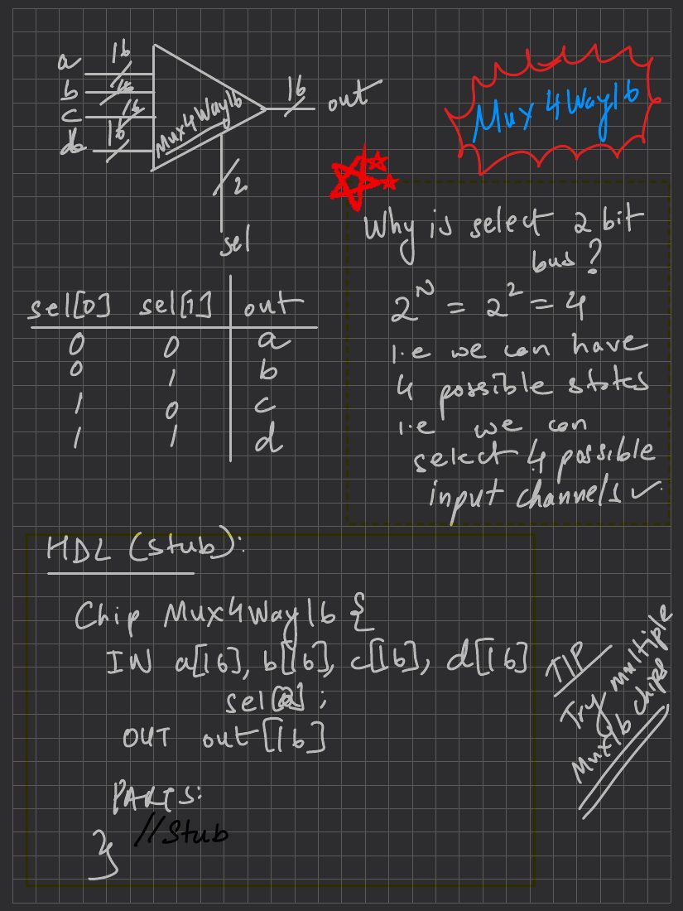

In [the first post](/posts/nand2tetris-01-boolean-logic/) I got from Nand to Xor: Boolean algebra, why one gate is
enough to build everything, and my first four chips. This post covers the second half of Unit 1. The new chips are
the first ones that *choose* between inputs rather than just compute a function of them, and the first ones that
work on 16 bits at once.

As before, the handwritten pages are my notes from the lectures. I've included the ones that show the working.

## Where things stand

| | |
|---|---|
| Built since last time | `Mux`, `DMux`, `And16`, all passing their tests |
| Project 1 total | 7 of 15 chips done |
| Next | `Not16`, `Or16`, `Mux16`, `Or8Way`, then the multi-way chips |

## Mux: a switch made of logic

A **multiplexer** has two data inputs, `a` and `b`, and a selector `sel`. It passes one of them through:

```txt
if (sel == 0) out = a
else          out = b
```

Three inputs means $2^3 = 8$ rows, so this is the same synthesis problem as last time: truth table first, then
formula.

| a | b | sel | out |
|:-:|:-:|:-:|:-:|
| 0 | 0 | 0 | 0 |
| 1 | 0 | 0 | **1** |
| 0 | 1 | 0 | 0 |
| 1 | 1 | 0 | **1** |
| 0 | 0 | 1 | 0 |
| 1 | 0 | 1 | 0 |
| 0 | 1 | 1 | **1** |
| 1 | 1 | 1 | **1** |



### Route 1: the algebra

DNF gives one term per row where out is 1:

$$
(a \land \lnot b \land \lnot sel) \lor (a \land b \land \lnot sel) \lor (\lnot a \land b \land sel) \lor (a \land b \land sel)
$$

Pair them up. The first two differ only in $b$, so $b$ cancels:
$(a \land \lnot sel) \land (b \lor \lnot b) = a \land \lnot sel$. The last two differ only in $a$, so they reduce
to $b \land sel$. That leaves

$$
\text{Mux}(a, b, sel) = (a \land \lnot sel) \lor (b \land sel)
$$

which reads exactly like the spec: let `a` through when `sel` is 0, let `b` through when `sel` is 1.

### Route 2: the Karnaugh map

The algebra worked, but I had to *spot* which terms paired up. A **Karnaugh map** makes the pairs visible. Lay the
truth table out as a grid, with `a` on the rows and `b sel` on the columns, and order the columns
**00, 01, 11, 10**. That's Gray code: neighbouring columns differ in exactly one bit, which isn't true of plain
binary order (01 → 10 flips two bits at once).

| a \ b sel | 00 | 01 | 11 | 10 |
|:-:|:-:|:-:|:-:|:-:|
| **0** | 0 | 0 | 1 | 0 |
| **1** | 1 | 0 | 1 | 1 |

Now circle groups of neighbouring 1s; the grid wraps around, so the first and last columns are neighbours too. In
each group, any variable that changes drops out:

- `a = 1`, `sel = 0` (columns 00 and 10, wrapping around): `b` changes, so the group is $a \land \lnot sel$.
- Column 11 (`b = 1`, `sel = 1`), both rows: `a` changes, so the group is $b \land sel$.

Same answer, and no algebra needed. Every 1 in the grid is covered by a group, so nothing else is needed.



### The HDL

```txt title="Mux.hdl"
CHIP Mux {
    IN a, b, sel;
    OUT out;

    PARTS:
    Not(in=sel, out=notsel);
    And(a=a, b=notsel, out=aAndNotsel);
    And(a=b, b=sel, out=bAndsel);
    Or(a=aAndNotsel, b=bAndsel, out=out);
}
```

:::note[An erratum to my own notes]
My handwritten HDL on page 19 uses `notsel` without the `Not` part that produces it. The chip file has it, and HDL
won't compile without it: every internal wire has to come out of some part.
:::

## DMux: the same idea backwards

A **demultiplexer** is the inverse of Mux: one input `in`, two outputs, and `sel` decides which output gets the
signal. The other output is 0.

```txt
if (sel == 0) {a, b} = {in, 0}
else          {a, b} = {0, in}
```

The new thing here is **two outputs**. A truth table with two output columns is just two Boolean functions
side by side, so you synthesise each one separately:

| in | sel | a | b |
|:-:|:-:|:-:|:-:|
| 0 | 0 | 0 | 0 |
| 0 | 1 | 0 | 0 |
| 1 | 0 | 1 | 0 |
| 1 | 1 | 0 | 1 |

$$
a = in \land \lnot sel \qquad b = in \land sel
$$

```txt title="DMux.hdl"
PARTS:
Not(in=sel, out=notsel);
And(a=in, b=notsel, out=a);
And(a=in, b=sel, out=b);
```

## Why choosing matters

Two examples from the lectures made Mux feel like more than an exercise.

**One wire, two conversations.** Put a Mux on one end of a wire and a DMux on the other, and toggle both `sel`
lines in sync. The Mux interleaves bits from `a` and `b` into a single stream, and the DMux splits them back out.
That's the idea behind time-division multiplexing in communication networks.



**A programmable gate.** Compute both `a And b` and `a Or b`, then let a Mux pick one. The `sel` input is now a
tiny program: 0 means "be an And gate", 1 means "be an Or gate".

```txt title="AndMuxOr.hdl"
CHIP AndMuxOr {
    IN a, b, sel;
    OUT out;

    PARTS:
    And(a=a, b=b, out=aAndb);
    Or(a=a, b=b, out=aOrb);
    Mux(a=aAndb, b=aOrb, sel=sel, out=out);
}
```



This is the pattern a CPU uses at scale: compute several things, then let control bits select which result goes
through. The ALU later in the course is this idea with more operations.

## Buses: thinking in 16 bits

A computer doesn't add single bits; it adds 16-bit numbers. Instead of drawing 16 wires, we treat them as a
**bus**: one entity that carries 16 bits at once.

Bits are indexed from the right. `a[0]` is the **least significant bit**, and in a 16-bit bus `a[15]` is the
**most significant**. It's the same as the digits of 305, where the 3 is worth the most.



:::note[Another erratum]
On page 16 I numbered the bus 16 … 0, which is 17 bits. A 16-bit bus runs 15 … 0.
:::

A **multi-bit gate** is the 1-bit gate applied to each position: `out[i] = a[i] And b[i]`. For example, with 8 of
the 16 bits:

```txt
a   = 1 0 1 1 0 1 1 0
b   = 0 1 1 0 0 1 1 1
out = 0 0 1 0 0 1 1 0
```

So `And16` is sixteen `And` parts, one per bit:

```txt title="And16.hdl"
PARTS:
And(a=a[0], b=b[0], out=out[0]);
And(a=a[1], b=b[1], out=out[1]);
// … one per bit …
And(a=a[15], b=b[15], out=out[15]);
```

It's repetitive, and that's the point. Nothing new happens at the logic level; the bus is purely a way to stop
drawing 16 wires.

## Next: more than two inputs

`Mux4Way16` chooses between four 16-bit inputs. To pick one of four you need two selector bits, because
$2^2 = 4$, so `sel` is itself a 2-bit bus:

| sel[1] | sel[0] | out |
|:-:|:-:|:-:|
| 0 | 0 | a |
| 0 | 1 | b |
| 1 | 0 | c |
| 1 | 1 | d |



:::note[Watch the bit order]
In my handwritten table the first column is `sel[0]`. But `sel[1]` is the high bit, so with the columns in that
order, the `b` and `c` rows swap. The table above is ordered `sel[1] sel[0]`, the way the test file reads it.
:::

My plan, which is also the hint I wrote myself: don't synthesise it from a 64-row table. Build it out of `Mux16`
chips, using one selector bit at each level.

<details>
<summary>Hint for Mux4Way16 (spoiler)</summary>

Two `Mux16`s choose with `sel[0]`, one between `a`/`b` and one between `c`/`d`. A third `Mux16` uses `sel[1]` to
choose between their two outputs.

</details>

## What these chips cost

Counting in Nand gates, as last time (Not = 1, And = 2, Or = 3):

| Chip | Built from | Nands |
|---|---|:-:|
| Mux | Not + 2 × And + Or | 1 + 4 + 3 = **8** |
| DMux | Not + 2 × And | 1 + 4 = **5** |
| And16 | 16 × And | **32** |

## Cheat sheet

- **Mux** $= (a \land \lnot sel) \lor (b \land sel)$. **DMux:** $a = in \land \lnot sel$, $b = in \land sel$.
- **Several outputs** = several Boolean functions; synthesise each column on its own.
- **Karnaugh map:** order columns in Gray code, circle neighbouring 1s (the grid wraps around), and drop the variables that change inside a circle.
- **Bus:** `x[0]` is the LSB, `x[15]` the MSB. A 16-bit gate is the 1-bit gate once per bit.
- **Selecting from $2^k$ inputs** needs a $k$-bit `sel`, and you can build it as a tree of 2-way Muxes.
