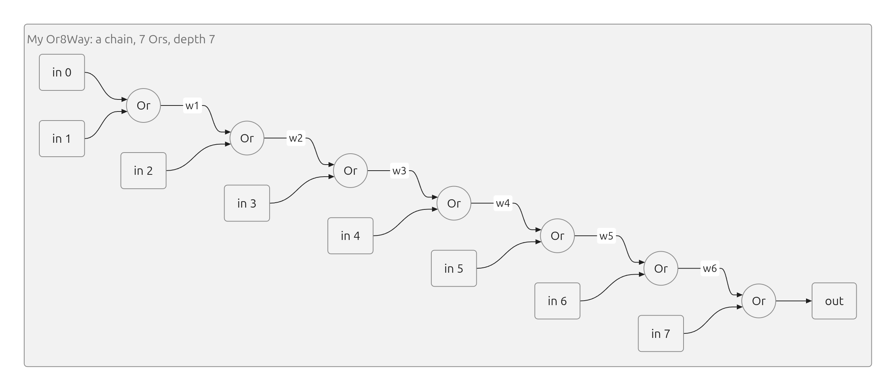
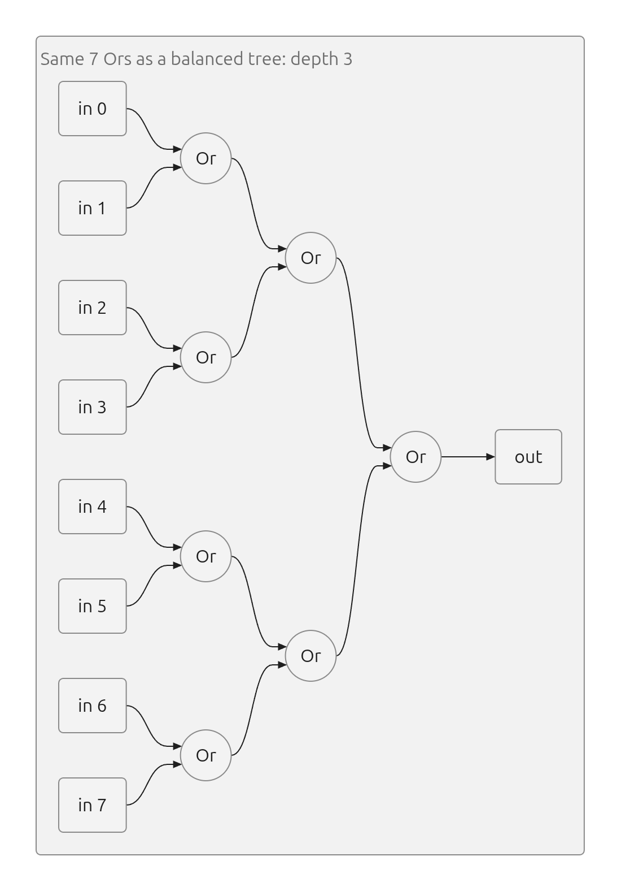
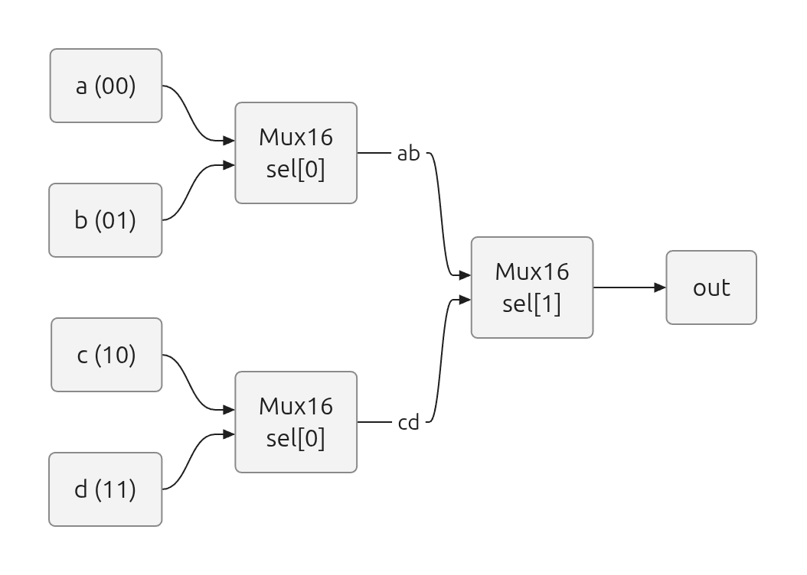
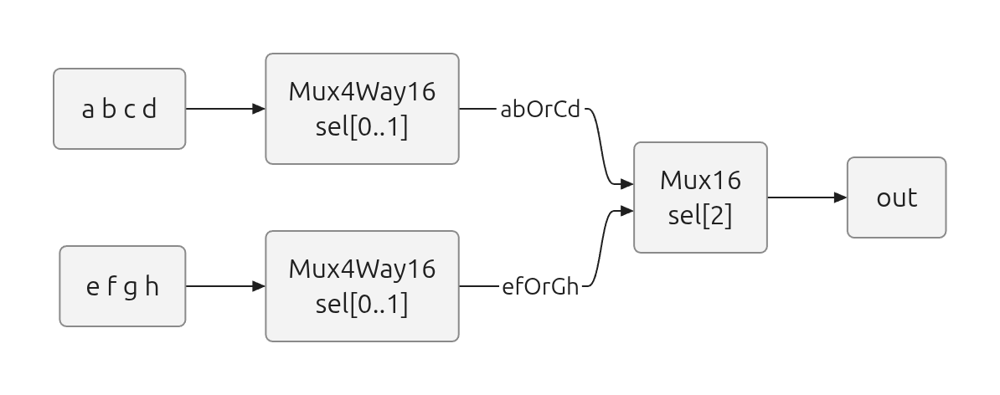

[Last time](/posts/nand2tetris-02-mux-dmux-buses/) I built `Mux`, `DMux` and `And16`, and ended with a plan for
`Mux4Way16`: don't synthesise it from a truth table, build it from smaller muxes. This post is about following that
plan through the rest of Project 1. All 15 chips now pass.

There was almost no new Boolean algebra this time. The new idea is *composition*: once a chip passes its test, it
becomes a black box, and the bigger chips are wired out of the smaller ones. I also made two mistakes worth writing
down, because both taught me something about how hardware is different from code.

## Where things stand

| | |
|---|---|
| Built since last time | `Not16`, `Or16`, `Mux16`, `Or8Way`, `Mux4Way16`, `Mux8Way16`, `DMux4Way`, `DMux8Way` |
| Project 1 total | **15 of 15 chips done** |
| Next | Project 2: adders and the ALU |

Here's the whole project, run from the command line:

```txt title="Terminal"
$ ./HardwareSimulator.sh ../projects/1/DMux8Way.tst
End of script - Comparison ended successfully
```

| Chip | Test |
|---|---|
| `Not` `And` `Or` `Xor` `Mux` `DMux` | ✅ |
| `Not16` `And16` `Or16` `Mux16` | ✅ |
| `Or8Way` `Mux4Way16` `Mux8Way16` `DMux4Way` `DMux8Way` | ✅ |

## Wide chips: the same gate, sixteen times

`Not16`, `Or16` and `Mux16` follow the pattern from `And16`: a 16-bit chip is the 1-bit chip applied to every bit
of the bus, with nothing connecting the bits to each other.

```txt title="Mux16.hdl"
CHIP Mux16 {
    IN a[16], b[16], sel;
    OUT out[16];

    PARTS:
    Mux(a=a[0], b=b[0], sel=sel, out=out[0]);
    Mux(a=a[1], b=b[1], sel=sel, out=out[1]);
    // … one Mux per bit …
    Mux(a=a[15], b=b[15], sel=sel, out=out[15]);
}
```

The one detail is that `sel` is a single wire shared by all sixteen Muxes, so every bit makes the same choice.

### Mistake 1: one wire, one driver

My first `Mux16` did *not* look like that. I was still thinking about the inside of a Mux (an `a` path guarded by
`not sel`, a `b` path guarded by `sel`), so I wrote two parts per bit, one for each case, both writing `out[i]`.

![Two Muxes both driving out[i] versus one Mux per bit](./onedriver.png)

The simulator refused to even load it:

```txt title="Terminal"
In HDL file Mux16.hdl, Line 7, An output pin may only be fed once by a part's output pin: load Mux16.hdl
```

And it's right to. In software, writing a variable twice just means the second write
wins. In hardware, a wire isn't a variable: two outputs connected to the same wire would be driven at the same
time, one possibly pulling it to 1 and the other to 0. So HDL has a rule: **a wire can have only one driver**. It can
fan out to as many inputs as you like, but only one output may feed it. To combine two signals you need a gate with
a single output, like `Or` or `Mux`.

The fix was to stop re-implementing Mux. The `notsel` logic belongs *inside* `Mux`, and once `Mux` exists, I use it
as a black box: one part per bit.

## Or8Way: folding a bus into one bit

`Or8Way` is the odd one out. It isn't bitwise: it takes 8 bits of one bus and answers a single question, "is *any*
of them 1?" So it Ors the bits together, one after another:

```txt title="Or8Way.hdl"
PARTS:
Or(a=in[0], b=in[1], out=w1);
Or(a=w1, b=in[2], out=w2);
Or(a=w2, b=in[3], out=w3);
Or(a=w3, b=in[4], out=w4);
Or(a=w4, b=in[5], out=w5);
Or(a=w5, b=in[6], out=w6);
Or(a=w6, b=in[7], out=out);
```



Folding 8 inputs with a 2-input gate always takes 7 gates, since each gate removes one value. But the *shape* is a
choice. Mine is a chain, so the last input has to wait for 7 gates in a row. The same 7 gates arranged as a
balanced tree only need 3 levels:



nand2tetris doesn't model gate delay, so both pass the same test. In real hardware the signal takes time to cross
each gate, so the chain's output settles after 7 gate delays and the tree's after 3. I'm leaving my chain as it is, but I want to remember
that "same function, same gate count" doesn't mean "same chip".

## Mux4Way16: a tournament

`Mux4Way16` picks one of four 16-bit inputs with a 2-bit `sel`. Before wiring anything I had to get the bit order
straight, because it's easy to read backwards:

```txt
sel = 1 0
      │ └── sel[0]  least significant bit (rightmost)
      └──── sel[1]  most significant bit (leftmost)
```

You *write* binary with the high bit on the left, but the indices count **from the right**. So `sel = 10` means
`sel[1] = 1` and `sel[0] = 0`, which selects `c`.

The chip is a two-round tournament. In round one, `a` plays `b` and `c` plays `d`, both decided by `sel[0]`. The
final, decided by `sel[1]`, picks between the two winners.



```txt title="Mux4Way16.hdl"
PARTS:
Mux16(a=a, b=b, sel=sel[0], out=ab);
Mux16(a=c, b=d, sel=sel[0], out=cd);
Mux16(a=ab, b=cd, sel=sel[1], out=out);
```

Why does this pairing work? `a` (00) and `b` (01) differ only in `sel[0]`, and so do `c` (10) and `d` (11). The
rule I took away: **the two inputs in a match must differ only in the bit that match decides.**

That rule also means the order isn't fixed. I checked by building the tree the other way round, with `sel[1]` in the
first round. Then the pairs have to be `a`/`c` and `b`/`d`, because those are the ones that differ only in `sel[1]`.
It passes the same test:

```txt title="Mux4Way16.hdl (sel[1] first, also passes)"
PARTS:
Mux16(a=a, b=c, sel=sel[1], out=ac);
Mux16(a=b, b=d, sel=sel[1], out=bd);
Mux16(a=ac, b=bd, sel=sel[0], out=out);
```

## Mux8Way16: reuse the black box

With `Mux4Way16` passing, `Mux8Way16` is one more round: two 4-way muxes handle `a…d` and `e…h` using the low two
bits, and a `Mux16` on `sel[2]` picks the half.

```txt title="Mux8Way16.hdl"
PARTS:
Mux4Way16(a=a, b=b, c=c, d=d, sel=sel[0..1], out=abOrCd);
Mux4Way16(a=e, b=f, c=g, d=h, sel=sel[0..1], out=efOrGh);
Mux16(a=abOrCd, b=efOrGh, sel=sel[2], out=out);
```



`sel[0..1]` is new syntax: it passes a 2-bit **slice** of the bus, which is exactly the `sel` a `Mux4Way16` expects.
I never have to think about the inside of `Mux4Way16` again. This is the interface/implementation split from the
first post, paying off.

## DMux4Way: mistake 2

A demultiplexer runs the tournament backwards: one input goes in, and each round sends it left or right until it
reaches one of the four outputs. I started with `sel[0]`, as in the Mux, and named my wires after the Mux too:

```txt title="DMux4Way.hdl (first try)"
PARTS:
DMux(in=in, sel=sel[0], a=ab, b=cd);
DMux(in=ab, sel=sel[1], a=a, b=b);
DMux(in=cd, sel=sel[1], a=c, b=d);
```

It failed:

```txt title="Terminal"
$ ./HardwareSimulator.sh ../projects/1/DMux4Way.tst
Comparison failure at line 7
```

Line 7 of the compare file is `in = 1, sel = 01`, which should light up `b`. My chip lit up `c`:

```txt
expected:  | 1 |  01  | 0 | 1 | 0 | 0 |
got:       | 1 |  01  | 0 | 0 | 1 | 0 |
```

The bug is in the *names*. The first DMux splits on `sel[0]`, so its `a` output carries the signal whenever
`sel[0] = 0`, which is the case for both `a` (00) and `c` (10). I called that wire `ab`, but it really carried
"a or c". Every wire after it inherited the wrong name, and `b` and `c` came out swapped.

![DMux4Way: the first try swaps b and c; the passing version splits on sel[1] first](./dmux4way.png)

I fixed it by splitting on `sel[1]` first, so that the names became true:

```txt title="DMux4Way.hdl" del={2-4} ins={5-7}
PARTS:
DMux(in=in, sel=sel[0], a=ab, b=cd);
DMux(in=ab, sel=sel[1], a=a, b=b);
DMux(in=cd, sel=sel[1], a=c, b=d);
DMux(in=in, sel=sel[1], a=ab, b=cd);
DMux(in=ab, sel=sel[0], a=a, b=b);
DMux(in=cd, sel=sel[0], a=c, b=d);
```

But the order wasn't really the problem. Keeping `sel[0]` first and
naming the wires honestly works just as well; I tried it, and it passes:

```txt title="DMux4Way.hdl (sel[0] first, honest names, also passes)"
PARTS:
DMux(in=in, sel=sel[0], a=ac, b=bd);
DMux(in=ac, sel=sel[1], a=a, b=c);
DMux(in=bd, sel=sel[1], a=b, b=d);
```

It's the same pairing rule as the Mux, read in the other direction: **each level decides one select bit, and a wire
is named after every output it can still reach.**

`DMux8Way` is then one more level, exactly like `Mux8Way16`:

```txt title="DMux8Way.hdl"
PARTS:
DMux(in=in, sel=sel[2], a=abcd, b=efgh);
DMux4Way(in=abcd, sel=sel[0..1], a=a, b=b, c=c, d=d);
DMux4Way(in=efgh, sel=sel[0..1], a=e, b=f, c=g, d=h);
```

## A crash that wasn't my chip

Running `DMux8Way`'s test crashed the Hardware Simulator's GUI with a `NullPointerException` in its table-scrolling
code. It's a repaint bug in the old Java Swing interface, triggered when it scrolls the script panel, and
`DMux8Way` has the longest test script so far. Two ways around it:

- set **Animate** to **No Animation** in the GUI, or
- skip the GUI and run the test from the command line, as above: `./HardwareSimulator.sh path/to/Chip.tst`.

## What these chips cost

Counting in Nand gates, as before (Not = 1, And = 2, Or = 3, Mux = 8, DMux = 5):

| Chip | Built from | Nands |
|---|---|:-:|
| Not16 | 16 × Not | **16** |
| Or16 | 16 × Or | **48** |
| Mux16 | 16 × Mux | **128** |
| Or8Way | 7 × Or | **21** |
| Mux4Way16 | 3 × Mux16 | **384** |
| Mux8Way16 | 2 × Mux4Way16 + Mux16 | **896** |
| DMux4Way | 3 × DMux | **15** |
| DMux8Way | DMux + 2 × DMux4Way | **35** |

The mux trees get expensive fast because every level is 16 bits wide. The demux trees stay cheap because they route
a single bit.

## Cheat sheet

- **Wide chip** = the 1-bit chip on every bit; a shared `sel` makes all bits choose the same way.
- **One driver per wire.** Fan-out is fine; two outputs on one wire is not.
- **Bit indices count from the right:** `sel = 10` means `sel[1] = 1`, `sel[0] = 0`.
- **Multi-way chips are trees of 2-way chips.** Each level decides one select bit, and the two wires in a match
  must differ only in that bit. Either order of bits works if the pairs follow it.
- **Name wires after what they really carry.** My only real bug in Project 1 was a wire called `ab` that carried a
  and c.
- **Same gates, different shape:** a chain and a tree of 7 Ors compute the same thing, but the tree is shallower.

## Next

Project 2 is Boolean arithmetic: a half adder, a full adder, a 16-bit adder, an incrementer, and then the ALU, the
first chip that does arithmetic rather than routing. The mux trees from this post come back there: the ALU uses
control bits to choose what it computes, which is the programmable-gate idea from the last post at full scale.
